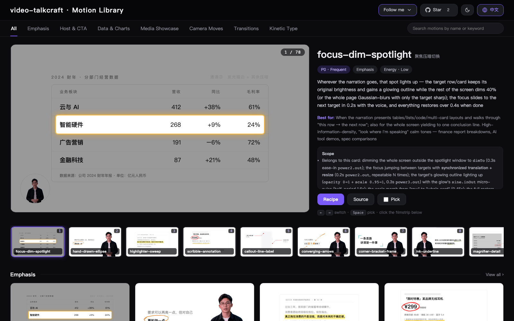
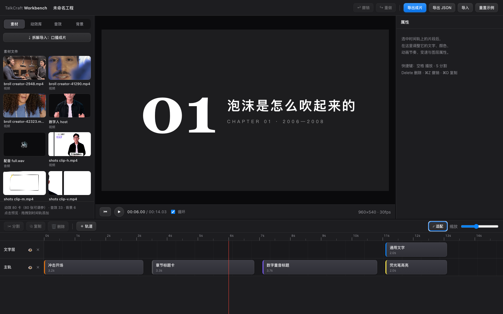

<div align="center">


<h1>video-talkcraft</h1>

[](https://vincentwei1021.github.io/video-talkcraft/)
[](LICENSE)

**ナレーション主導の高品質な動画を作るためのエージェントスキル：単語単位のナレーション同期 · 108 のモーションレシピカード · スライドショー化を防ぐ 7 層のショットシステム · 3 重のゲートによる QA**

[中文](README.md) | [English](README_EN.md) | [日本語](README_JA.md)

</div>

**video-talkcraft** は、[video-shotcraft](https://github.com/Vincentwei1021/video-shotcraft) シリーズの
ナレーション主導の解説動画編です。
Claude Code や Codex を、ナレーション付きの解説動画のためのモーションデザインスタジオに変える
AI エージェントスキルです。ナレーションの台本と完成したナレーション音声を渡すと、
ローカルで単語単位のタイムスタンプを揃え、意味の区切りごとに SHOTBOOK に絵コンテを起こし、
[Remotion](https://www.remotion.dev/) で洗練された解説動画をレンダリングします。キネティックタイポグラフィ、根拠となるスクリーンショット、
カメラワーク、プレーンカットの字幕、映画品質の効果音が、すべて声にぴったり合わせられます。

> 方法論のドキュメントとレシピカードは中国語で書かれています。このツールキットは
> 中国語のナレーションを第一に考えて作られています（中国語と英語が混在したナレーションにも完全に対応しています）。
> エージェントはそれらをそのまま読み取れます。

🖼️ [**ライブギャラリーで 108 のモーションプレビューをすべて見る »**](https://vincentwei1021.github.io/video-talkcraft/)

[](https://vincentwei1021.github.io/video-talkcraft/)

## 🆕 新機能
<!-- Style rule: one sentence per entry, ≤ 350 characters including the pointer link, stating what it is and what behaviour changed; details, parameters and card lists point to references / SKILL.md sections instead of being expanded here. Keep zh and en in sync. Set by PR #12 (2026-09-05); #14/#18 drifted back to long paragraphs, tightened again 2026-09-07. -->

**2026-09-11**

- ✂️ **ナレーションの事前トリミング `scripts/voice_trim.py`** — 人の録音を、タイムスタンプを付ける前にクリーンアップするようになりました。台本を正解として、フィラー / どもりや言い直し / 長すぎる間をカットします（台本にない挿入だけをカットし、台本にある文字の ASR の聞き間違いは決してカットしません）。単語のタイミングは FireRed ASR、文字ごとの SRT、または単語単位の JSON から取得し、カットの位置はフレームのグリッドに吸着します。同じ EDL で出演者の動画もトリミングできるため、音声と映像がフレーム単位で揃ったままになります（→ SKILL.md ②-0）。
- 🫥 **ワークベンチ：右クリック → アルファ付きでエクスポート** — タイムライン上の任意のモーションクリップを右クリックすると、そのクリップだけを透明な動画（MOV ProRes 4444 または WebM VP9 alpha）としてレンダリングできます。キャンバスは透明で、カードのルートの背景と出演者のシルエットのプレースホルダーは自動的に取り除かれ、CapCut / Premiere / After Effects のオーバーレイとしてそのまま使えます。同じメニューには分割 / 複製 / 削除もあります（→ `workbench/GUIDE.md` ⑦）。
- 📺 **ワークベンチのライブ制作ボード（L1）** — ⑤-1 の骨組みができた時点でワークベンチが接続され、開いたままになります：ステージバー、ショットごとの進捗トラック（プレースホルダー / 実装済み / レンダリング済み / 合格 / 古い / 未解決の問題の点）、ショットのビュー（単一ショットのプレビュー、問題、SHOTBOOK の抜粋）、ライブのコンポジションカード。状態はディスク上の成果物から導出され、`scripts/pipeline_state.mjs --pass/--issue` は人の判定だけを記録し、書きかけのコードでページが真っ白になることはなくなりました（→ SKILL.md ⑤-2、`workbench/docs/live-pipeline.md`）。
- 🔗 **ワークベンチのプロジェクト接続を強化** — `kbsrc` は実際のパスを通じて解決するようになり、契約の各モジュールは個別にスタブにフォールバックし、`src/kb/` がエクスポートの形を正規化します：通常のスキルで作られたプロジェクト（`Main.tsx` + `scenes/`、プロモーション用のモジュールなし）を接続しても、ページ全体が 500 エラーになることはなくなりました。また、契約を満たさない場合は「拆解导入」（分割インポート）が理由を示して自動的に無効になります（→ `workbench/README.md`、「接入口播成片工程」）。

**2026-09-09**

- 🎬 **残りより先に最初のショットを** — ステップ ⑤ では、コンポジション全体をプレースホルダーのショットで組み立て、サンプルのショットだけを作り、`--seg-audio`（音声トラック全体なし）で単一ショットのプレビューとしてレンダリングしてユーザーの承認を得てから、残りのショットを作るようになりました。⑥-1.5 に残るのは「全体をレンダリングするか、ショットごとか」という質問だけです（→ SKILL.md ⑤-1）。

**2026-09-07**

- ✏️ **G5 の線画の図解システム** — テキストだけのショットには、必ずアイコン + 枠 + 矢印の線画を付けます。テキストを裸のまま置くことはなく、1 文につき少なくとも 1 つ目に見える変化を入れ、その付随する行がない場合はプリフライトで WARN を出します（→ `template/motion-systems/schematic.tsx`、`references/schematic.md`）。
- 🎞️ **8 種類の動画のテーマフレームとチャプターのテーマレイヤー** — 単一の動画のショットは、1 つのテーマのフレーム（ブラウザのウィンドウ / フィルム / インスタント写真 / 設計図など 8 種類。1 本の作品につき 1 つのフレームで、偽のプレイヤーは使いません）の中に置く必要があり、チャプターのカードはチャプターごとに色と線画のモチーフを切り替えます（→ `template/components/theme-frame.tsx`、design-language §1.3）。

**2026-09-05**

- 🔁 **video-shotcraft から 19 枚のカードを移植（89 → 108）** — 姉妹ライブラリ [video-shotcraft](https://github.com/Vincentwei1021/video-shotcraft) を 2 回レビューして 19 枚を残しました（2026-09-06 にフリーズフレームの注釈を削除し、現在は 18 枚）。それぞれの tsx はこのライブラリの自己完結型の契約に合わせて書き直し、出典を明記しています（→ `references/taxonomy.md` のバッチ ◎）。
- 🎨 **ドメイン主導のスタイルとカードのスキニング** — 絵コンテを起こす前に、台本のドメインからスタイルのプロファイルを導き出します（SHOTBOOK G0）。ライブラリのカードはニュートラルな UI で、モーションの要となる値には手を加えずに、そのプロファイルに合わせてスキンを変えます。ショットごとにスキニングの行を 1 行書きます（→ `references/design-language.md` §0）。
- 🧩 **複数のアセットを使う 10 枚の新しいカード（79 → 89）** — 並列の文のレイアウト、3 連のリレー、比較スライダー、フィルムストリップ、スタックの扇形展開、ギャラリーウォールのドリー / タイムラインの写真の帯など。どのカードにも入力の種類とよくあるシナリオが記載されているので、カードの選択はショットの素材で絞り込むことから始めます（→ `references/taxonomy.md` の入力の種類の索引）。
- 📐 **レイアウトの仕様 `references/layout.md`** — 12 カラムのグリッド、余白のトークン、最小の文字サイズ、重ならないボックス、9 項目の静止画チェック。選んだ各カードの落とし穴 / 配置のチェックは、SHOTBOOK に書き写す必要があります。
- 🎨 **12 種類の動的な背景を同梱** — `template/motion-systems/backdrop.tsx`。ダーク 6 種類 / ライト 6 種類で、フレーム駆動でランダム性はありません。デフォルトは、ライトが `pastel-mesh-flow`、ダークが `mesh-flow-dark` になりました。

**2026-09-04**

- 🎥 **モーションシステムをスリム化** — シーンごとに、ごくゆっくりとしたプッシュ / プルのカメラの曲線を 1 つと、譲りのライフサイクルだけにしました。待機中の揺れ、呼吸、パルスはデフォルトでオフです。
- 🌐 **Web ページは貼り付けるのではなく撮影する** — ページは静的なスクリーンショットとして表示するのではなく、カメラで撮影します（スクロール、ツアー、拡大鏡、蛍光ペン）。すべての座標は Playwright の計測値から読み取ります（→ SKILL.md §③、`references/shot-design.md` §2④）。

**2026-09-02**

- 🎛️ **モーションワークベンチ `workbench/`** — 完成した動画のための、CapCut 風のポストプロダクションのデスクです：マルチトラックのタイムライン、
  ライブラリ（メディア / モーションカード / 効果音 / 背景）、スキーマ駆動のインスペクター、ライブプレビュー、ワンクリックの **エクスポート**。
  108 枚のモーションカードはすべてパラメーター化されています（コピー、色、サイズ、位置を編集でき、タイミングの要となる値は固定）。
  ナレーション動画は、7 種類の編集可能な単位に分割できます：字幕 / トランジション / 環境 /
  アバター / ショット / ナレーション / 効果音。納品後、スキルがワークベンチを開いてくれます。→ [**図解ガイド（中国語）**](workbench/GUIDE.md)

  <a href="workbench/GUIDE.md"></a>

- ⚡ **より速いレンダリング：ショット単位で分割したマスターのレンダリング** — `scripts/render_shots.mjs` は、ショットごとのセグメントを
  並列でレンダリングし（ラスタライズの一貫性を保つため、各セグメントの中ではシングルプロセス）、それらを連結し、音声トラック全体をミックスして、
  フレーム数を検証します。1 つのショットを変更すると、そのセグメントと前後のセグメントだけが再レンダリングされます。
  `scripts/render_stills.mjs` は、1 つのバンドルから静止画をまとめてレンダリングします。
- 🧮 **レビューのトークンを削減** — `scripts/contact_sheet.py` は、レビュアーのサブエージェントのために、QA のフレームを 3×4 のシートに並べます。
  連写の 3 枚組は、`"burst": true` のフラグが付いたアンカーでのみ抽出されます（以前はレビュー素材の 2/3 を占めていました）。
- ✅ **1 回のレビューで納品** — 機械的なゲートを通過したら、1 回の独立したレビューで
  P0/P1 を修正して動画を出荷します。「問題がなくなるまで繰り返す」のではなく、追加のラウンドは任意（最大 3 回）です。

| 実測値（201 秒の縦型動画） | 以前 | 現在 |
|---|---|---|
| 最初の全体のレンダリング | 13 分 | 9 分 |
| 1 つのショットを変更したあとの音声付きの新しい動画 | 全体を再レンダリング | 53 秒 |
| 43 枚のサンプルの静止画 | 11 分 | 約 1 分 |
| レビュアーが 160 枚の QA のフレームを読む | 約 16 万トークン / 21 分 | 約 4 万トークン / 7 分（シート） |

- 🤝 新しいカード：コミュニティから提供された **douyin-follow-card**（[@scpcn01vision-oss](https://github.com/scpcn01vision-oss)）。合計 79 枚になりました。

## ✨ ハイライト

- **単語単位のナレーションの同期** — `scripts/timestamps_cpu.py` が、
  台本を音声に合わせます（デフォルトは FireRedASR2-CTC int8 で、ダウンロード不要のフォールバックとして
  faster-whisper を使います）。110 秒の中英混在のナレーションで、GPU の強制アライナーと
  比較したベンチマークでは、文字ごとのずれの中央値は 20〜40 ms、
  最悪でも 200 ms で、QA の誤検知はゼロでした。すべてのモーションの拍が、
  正確な単語に合わせられます。
- **108 のモーションレシピカード** — それぞれに意図、パラメーター、既知の落とし穴、
  コピーしてそのまま使える自己完結型の Remotion の tsx のソース、実行可能な HTML の
  プレビューが付いています。すべて
  [オンラインのギャラリー](https://vincentwei1021.github.io/video-talkcraft/)で、または
  ローカルで `open gallery/index.html` を使って閲覧できます。キネティックタイポグラフィ、データのショット、根拠のツアー、
  6 種類のモーションを引き継ぐトランジション、長回しのワールドキャンバス、出演者の
  合成などがあります。
- **スライドショー化を防ぐ 7 層のシステム** — シーンごとにごくゆっくりとしたプッシュインまたはプルアウトのカメラの
  曲線を 1 つ、譲りのライフサイクル、6 種類のモーションを引き継ぐトランジション（2026-09-04 に
  スリム化：被写体の待機と呼吸する環境は必須ではなくなりました）。静止して固まった
  フレームは構造的に起こりえません（万一すり抜けても、自動的に
  検出されます）。
- **レビューに耐えるレイアウトの規律** — 意味の区切りによる絵コンテ、
  画面上の要素の予算、余白のアンカー、転換の文でのカットのルール、
  そして目視ではなく実際の検出（`scripts/face_bbox.py`）で測定した
  顔のセーフゾーン。
- **3 重のゲートによる QA** — 静止の自動検出、単独トラックでのキューごとの効果音のエネルギーの
  検証、そしてアンカーフレームを手にした独立したレビュアーによるチェック（状態が切り替わるアンカーでの
  連写の 3 枚組も含み、単一のフレームでは見えない時間軸上の欠陥を捉えます）。

## 🚀 クイックスタート

**最も直接的な方法：リポジトリのリンクをエージェントに渡すことです。**
Claude Code / Codex などのエージェントで、こう伝えるだけです：

```text
Install this skill for me: https://github.com/Vincentwei1021/video-talkcraft
```

または、[skills](https://skills.sh/) の CLI を使うか、手動でインストールします：

```bash
npx skills add Vincentwei1021/video-talkcraft
```

```bash
git clone https://github.com/Vincentwei1021/video-talkcraft.git
cd video-talkcraft
ln -s "$(pwd)" ~/.claude/skills/video-talkcraft   # Claude Code
# or
ln -s "$(pwd)" ~/.codex/skills/video-talkcraft    # Codex
```

環境（必要に応じてエージェントがセットアップします）：

- Node 18+（Remotion のレンダリング。動画ごとのプロジェクトの中で `npm install`）
- Python 3.10+
  - ローカルの CPU でタイムスタンプを揃える場合：`pip install zhconv pypinyin sherpa-onnx soundfile numpy`
    （767 MB の FireRedASR2-CTC のモデルを一度だけダウンロードします。または `--backend whisper` を使います）
  - 1 ステップのクラウド TTS + タイムスタンプ（Fish Audio の無料枠）の場合：`pip install requests python-dotenv`
- ffmpeg

その後、次のように依頼します：

```text
Use video-talkcraft to turn this narration script + voiceover.wav into a video.
Make a 100-second explainer about <topic>; here is the script and the audio.
```

### 🎙️ オプション：Fish Audio によるナレーション + 文字ごとのタイムスタンプ

完成したナレーション音声とローカルの CPU による位置合わせが、引き続きデフォルトのワークフローです。ナレーションを合成する必要がある場合は、Fish Audio を選んでください。スクリプトはデフォルトで `s2.1-pro-free` を要求します。無料の枠とモデルの利用可否は Fish Audio が管理しています。

1. `ffmpeg` と Python の依存関係をインストールします：`pip install requests python-dotenv`。
2. `.env.example` を `.env` にコピーして、`FISH_AUDIO_API_KEY` を設定します。必要に応じて、`FISH_AUDIO_REFERENCE_ID` に音声ライブラリの音声 ID を設定します。空のままにすると、サービスのデフォルトの音声が使われます。
3. `script.json` を用意します。例：`{"sentences": ["First sentence.", "Second sentence."]}`。JSON の文字列の配列や、1 行に 1 文を書いた `.txt` ファイルも使えます。
4. 音声とタイムスタンプを生成します：
   ```bash
   # Default: one request per sentence, with 0.25 seconds of actual silence inserted between requests
   python3 scripts/tts_fishaudio.py script.json audio/full.wav audio/timestamps.json --timing-out remotion/src/timing.json
   # One request for the whole script; retain the model's natural pacing
   python3 scripts/tts_fishaudio.py script.json audio/full.wav audio/timestamps.json --timing-out remotion/src/timing.json --mode stream
   ```

どちらのモードも、SSE で音声と位置合わせのスナップショットを受け取ります。**ファイルは合成が終わってから書き出され、ストリーミング再生は実装されていません。** `--pause-sec` は、文ごとのモードでの追加の無音だけを制御します。各レスポンスは、連結とエンコードの前に PCM にデコードされ、オフセットには実際にデコードされたサンプル数を使います。`--format mp3|wav|opus` は API のレスポンスの形式を選び、音声の出力の拡張子が保存する形式を決めます。

中国語の文字は API の位置合わせの区間をそのまま保持し、英語の文字の時間は各単語の中で補間され、句読点の長さはゼロになります。音声が空の場合、位置合わせが欠けているか無効な場合、デコードに失敗した場合、正規化したテキストが一致しない場合は、エラーで終了します。正規化では句読点、大文字と小文字、文字幅を無視しますが、`2` と `two` のような、数字の読み方の置き換えを推測することはありません。そのような場合は読み上げる形のテキストを使うか、既存の録音でローカルの CPU による位置合わせを使ってください。`match=1` / `ok=true` はテキストの対応付けを確認するもので、発音や、独立して検証されたタイミングの正確さを確認するものではありません。結果は聞いて確かめてください。

オフラインの回帰チェック（API キーは不要。`requests` と `ffmpeg` が必要）：
```bash
python3 -m unittest discover -s scripts -p 'test_*fish*.py' -v
```

## 🎞 あなたが用意するものと、スキルがすること

| あなたが用意するもの（入力） | スキルがすること |
| --- | --- |
| ナレーションの台本 | 文ごとの QA のフラグ付きの、単語単位のタイムスタンプの位置合わせ |
| 完成したナレーション音声（任意の TTS または人の録音） | SHOTBOOK による絵コンテ：意味の区切り、レイヤーのマトリクス、レイアウトの予算 |
| オプションの出演者の映像（普通の動画で大丈夫です。キーイングと顔のゾーンのツールが付属しており、グリーンスクリーンだと最もきれいに抜けます） | 4 つの全体的なシステム（カメラ / パララックス / 譲り / 環境）、トランジション、効果音の配置による Remotion での実装 |
| オプションの B ロール / スクリーンショット | レンダリング + 3 重のゲートによる QA（機械的なゲートがすべて緑 + P0/P1 を修正する 1 回の独立したレビューのあとに納品。追加のラウンドは任意で最大 3 回）、ラウドネスを正規化した納品 |

## 📦 含まれるもの

| 内容 | 説明 |
| --- | --- |
| 108 のモーションレシピカード | 意図、エネルギー、パラメーター、実装のメモ、既知の落とし穴。どのカードにも自己完結型の Remotion の tsx のソース（`template/cards/`。1 ファイルをコピーするだけで使えます）と、実行可能な HTML のデモが付いています |
| ギャラリー | [オンライン](https://vincentwei1021.github.io/video-talkcraft/)またはローカル（`open gallery/index.html`）で、108 のプレビューをすべて閲覧・自動再生し、名前やキーワードで検索できます |
| モーションシステム | CameraRig（ゆっくりとしたプッシュ/プル）、譲りのライフサイクル、6 種類のトランジション、長回しのワールドキャンバス。パララックスと環境のレイヤーはオプション（`template/motion-systems/`） |
| コンポーネント | プレーンカットの字幕、装飾文字のタイトル、スマッシュワード、ハイライトのスイープ、鉛筆の描画、数字のロール、8 種類の動画のコンテナフレーム（`template/components/`） |
| パイプラインのスクリプト | 単語単位のタイムスタンプ（2 種類の ASR のバックエンド）、顔のゾーンの検出、静止のチェック、効果音の存在のチェック、QA のフレームの抽出（`scripts/`） |
| 方法論 | デザイン言語（デフォルトは Apple のパラダイム）、ショットのデザインのワークシート、撮影のルール、絵コンテの形式、QA の評価基準（`references/`） |
| 組み込みの効果音 | カードごとのサウンドキューの表と、デモのライブラリに組み込まれた実際のサンプル（ライセンスは `demos/_lib/sfx/ATTRIBUTION.md`） |

## 🗂 リポジトリの構成

```text
video-talkcraft/
├── SKILL.md                    # Agent entry point: the 8-step pipeline and hard rules
├── references/
│   ├── design-language.md      # Default visual system (palette/type/layout/subtitles)
│   ├── shot-design.md          # 3-plane worksheet + 7 shot-type presets
│   ├── cinematography.md       # 7-layer model, transitions, layout budget, QA gates
│   ├── shotbook-example.md     # A full storyboard example
│   ├── cards/                  # 108 motion recipe cards
│   ├── taxonomy.md             # Card index by category and source
│   ├── broll-sources.md        # Attribution-free stock sources (APIs, license traps)
│   ├── host-footage.md         # Host footage: input spec, keying, face safety zone
│   └── demo-spec.md            # Card/demo authoring spec
├── demos/                      # 108 runnable HTML previews (+ shared lib with embedded SFX)
├── gallery/                    # One-page local gallery
├── template/                   # Copy-paste Remotion code
│   ├── cards/                  # Per-card self-contained tsx sources (the skill's primary reference)
│   ├── motion-systems/         # Camera / parallax / yield / environment / transitions / long-take
│   └── components/             # Subtitles, flower words, smash words, pencil, etc.
└── scripts/                    # Timestamps, face bbox, QA tooling
```

ワークフロー全体については、[SKILL.md](SKILL.md) から読み始めてください。

## ❓ よくある質問

**video-talkcraft とは何ですか？**
ナレーションの台本と完成したナレーション音声から、フルアニメーションのナレーション主導の
解説動画を作る、オープンソースの AI エージェントスキル（Claude Code / Codex 向け）です。
編集ソフトでもテンプレートのサイトでもありません。エージェントが方法論を読み、
モーションレシピカードを選び、[Remotion](https://www.remotion.dev/) のコードを書き、
3 重のゲートによる QA を実行して、公開できる状態の解説動画を納品します。

**どんな動画を作れますか？**
横長のナレーション主導の解説動画です：知識の解説、製品の
レビュー、ニュースの解説、意見の論評など。中国語のナレーションを第一に設計されていますが、中国語と英語が混在した
ナレーションにも完全に対応しています。

**何を用意する必要がありますか？**
ナレーションの台本（テキスト）と完成したナレーション音声（任意の TTS または人の
録音）です。出演者の映像と B ロールはオプションです。

**無料ですか？**
個人、教育、研究の目的では無料で（PolyForm Noncommercial
1.0.0）、作成した動画はあなたのものです。ツールキット自体を商用利用するには、
事前の許可が必要です（下記参照）。

## 📄 ライセンス

[PolyForm Noncommercial 1.0.0](LICENSE) — 個人、教育、
研究の目的では無料です。**ツールキットのあらゆる商用利用には、事前の
許可が必要です** — [vincentwei1021@gmail.com](mailto:vincentwei1021@gmail.com) にメールするか、
GitHub の Issue を作成してください。

**このスキルで作成した動画はあなたのものです。** 役に立った場合は、動画の説明欄で
作者のアカウントに触れていただけると嬉しいですが、まったくの任意です。

## 🔊 音声とアセットについての注記

- 組み込みの効果音のサンプル：出典とライセンスは
  [demos/_lib/sfx/ATTRIBUTION.md](demos/_lib/sfx/ATTRIBUTION.md) にあります。
- B ロールの素材集めのガイドでは、クレジット表記が不要なストック素材（Pexels、
  Pixabay、Mixkit Free、Coverr、NASA）だけを認め、却下したものについてはライセンス上の落とし穴を
  記録しています。[references/broll-sources.md](references/broll-sources.md) をご覧ください。
- デモの出演者の映像（`demos/_lib/dh-host.webm`）は、プレースホルダーとして使っている AI 生成の
  プレゼンターです。本番では、ご自身の出演者の映像に置き換えてください。

## 🙏 謝辞

- **[Remotion](https://www.remotion.dev/)** — ここでのすべてのレンダリングを支える React の動画フレームワーク（独自の
  [ライセンス](https://github.com/remotion-dev/remotion/blob/main/LICENSE.md)にご注意ください）。
- **[sherpa-onnx](https://github.com/k2-fsa/sherpa-onnx)** を通じた **[FireRedASR2](https://github.com/FireRedTeam/FireRedASR2S)** と、
  **[faster-whisper](https://github.com/SYSTRAN/faster-whisper)** — タイムスタンプの
  バックエンドです。**Qwen3-ASR/ForcedAligner** をベンチマークの
  基準として使いました。
- **OpenCV YuNet** — 顔のセーフゾーンのルールを支える顔検出器。
- **Pexels · Pixabay · NASA · Mixkit** — クレジット表記が不要なアセットの提供元。
- **Claude Code** — このライブラリは、スキルが教えるのと同じレビューのループを使って、AI の
  コーディングエージェントとともに構築、改良、QA されました。

## フォローする

<p>
  <a href="https://x.com/VincentWei93"></a>
  <a href="https://www.douyin.com/user/MS4wLjABAAAAK1pkjBxilk2Oi_9h_vFyD-lTAu9CTlvhmOtkosDvvxg"></a>
  <a href="https://xhslink.cn/m/At9iP2d5C1V"></a>
</p>
