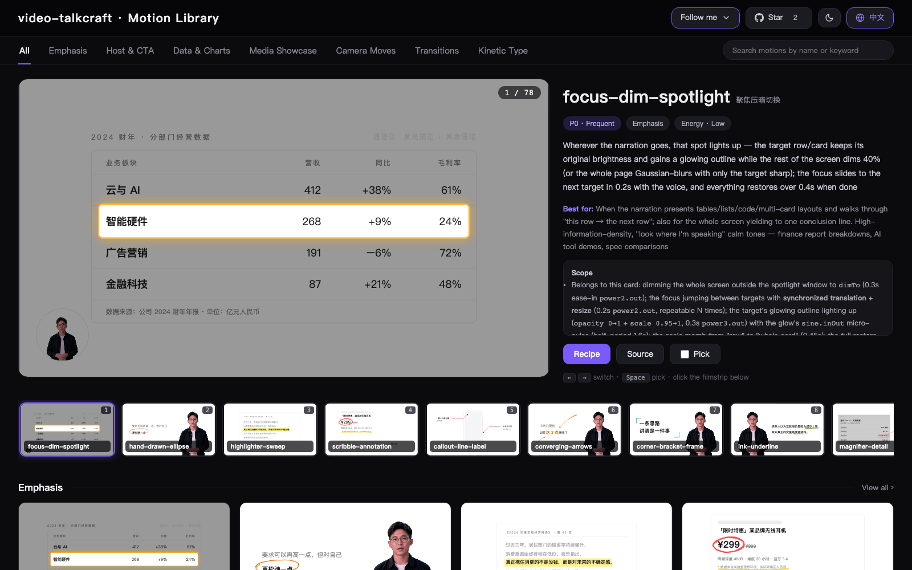
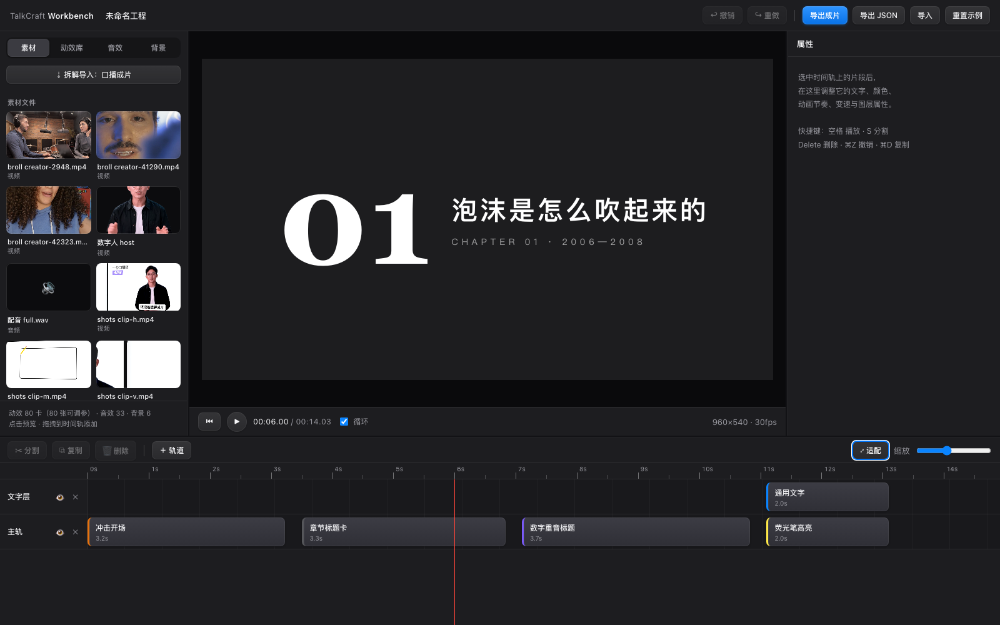

<div align="center">


<h1>video-talkcraft</h1>

[](https://vincentwei1021.github.io/video-talkcraft/) <a href="#wechat-community"></a>
[](LICENSE)

**Yüksek kaliteli seslendirme odaklı videolar üretmek için bir ajan becerisi: kelime düzeyinde ses senkronizasyonu · 108 hareket tarif kartı · 7 katmanlı slayt-karşıtı çekim sistemi · üç kapılı kalite güvencesi (QA)**

<a href="#support"></a>

[中文](README.md) | [English](README_EN.md) | [日本語](README_JA.md) | [Türkçe](README_TR.md)

</div>

**video-talkcraft**, [video-shotcraft](https://github.com/Vincentwei1021/video-shotcraft) serisinin seslendirme odaklı açıklayıcı video (explainer) sürümüdür: Claude Code veya Codex'i, seslendirmeli açıklayıcı videolar üreten bir hareket tasarımı (motion-design) stüdyosuna dönüştüren bir yapay zekâ ajan becerisidir. Bir anlatım metni ve hazır seslendirme dosyası verin; kelime düzeyinde zaman damgalarını yerel olarak hizalasın, her anlamsal vurguyu bir SHOTBOOK (çekim defteri) hâlinde kurgulasın ve ardından [Remotion](https://www.remotion.dev/) ile kinetik tipografi, kanıt ekran görüntüleri, kamera hareketleri, düz kesim altyazılar ve sinema kalitesinde ses efektlerinin (SFX) tamamı sese kilitli, cilalı bir açıklayıcı video üretsin.

> Metodoloji belgeleri ve tarif kartları Çince yazılmıştır — araç seti öncelikle
> Çince anlatım odaklı tasarlanmıştır (karışık Çince/İngilizce anlatım tam olarak
> desteklenir). Ajanlar bu belgeleri doğrudan okuyabilir.

🖼️ [**Canlı Galeride 108 hareket önizlemesinin tamamına göz atın »**](https://vincentwei1021.github.io/video-talkcraft/)

[](https://vincentwei1021.github.io/video-talkcraft/)

## 🆕 Yenilikler

**2026-09-11**

- ✂️ **Ses ön kırpma `scripts/voice_trim.py`** — insan sesi kaydı artık zaman damgalama öncesinde temizlenir; dolgu sözcüklerini, kekelemeleri, tekrar çekimleri ve aşırı uzun duraklamaları kesmek için metin temel referans olarak kullanılır (yalnızca metinde yer almayan eklemeler kesilir, metindeki karakterlerin ASR tarafından yanlış duyulması asla kesilmez); kelime zamanlamaları FireRed ASR, karakter bazlı SRT veya kelime düzeyinde JSON'dan gelir, kesim noktaları kare ızgarasına oturur ve aynı EDL sunucu videosunu da kırparak ses ile görüntüyü kare düzeyinde hizalı tutar (→ SKILL.md ②-0).
- 🫥 **Workbench: sağ tık → alfa kanallı dışa aktarma** — zaman çizelgesindeki herhangi bir hareket klibine sağ tıklayarak yalnızca o klibi şeffaf arka planlı video (MOV ProRes 4444 veya WebM VP9 alpha) olarak işleyin; kartın kök arka planı ve sunucu silüeti yer tutucusu otomatik olarak kaldırılır, CapCut / Premiere / After Effects içinde katman (overlay) olarak kullanıma hazırdır; aynı menüde böl / çoğalt / sil seçenekleri de bulunur (→ `workbench/GUIDE.md` ⑦).
- 📺 **Workbench canlı üretim panosu (L1)** — workbench artık ⑤-1 iskeleti oluştuğu anda bağlanır ve açık kalır: aşama çubuğu, çekim başına ilerleme izi (yer tutucu / uygulandı / işlendi / geçti / güncel değil / açık sorun noktası), çekim görünümü (tek çekim önizleme, sorunlar, SHOTBOOK özeti) ve canlı kompozisyon kartı; durum diskteki çıktılardan türetilir, `scripts/pipeline_state.mjs --pass/--issue` yalnızca insan kararlarını kaydeder ve yarım yazılmış kod artık sayfayı boşaltmaz (→ SKILL.md ⑤-2, `workbench/docs/live-pipeline.md`).
- 🔗 **Güçlendirilmiş workbench proje bağlantısı** — `kbsrc` artık gerçek yol üzerinden çözümlenir, her sözleşme modülü bağımsız olarak kendi taslağına (stub) geri döner ve `src/kb/` dışa aktarım biçimlerini normalleştirir: standart beceriyle oluşturulmuş bir projeyi (`Main.tsx` + `scenes/`, tanıtım modülleri olmadan) bağlamak artık tüm sayfada 500 hatasına yol açmaz ve sözleşme karşılanmadığında "拆解导入" (bölerek içe aktarma) nedenini belirterek kendini devre dışı bırakır (→ `workbench/README.md`, "接入口播成片工程").

**2026-09-09**

- 🎬 **Diğerlerinden önce ilk çekim** — ⑤. adım artık tüm kompozisyonu yer tutucu çekimlerle kurar, yalnızca örnek çekimi oluşturur, kullanıcı onayı için `--seg-audio` ile tek çekim önizlemesi olarak işler (tam ses izi olmadan) ve ancak onayın ardından kalan çekimleri üretir; ⑥-1.5 yalnızca "tam render mı, çekim çekim mi" sorusunu korur (→ SKILL.md ⑤-1).

**2026-09-07**

- ✏️ **G5 çizgi-sanat şematik sistemi** — yalnızca metin içeren her çekim bir simge + kutu + ok çizimi taşımalıdır, metin asla çıplak yerleştirilmez, her cümlede en az bir görünür değişiklik bulunur ve bu eşlikçi satır eksik olduğunda ön kontrol (preflight) UYARI verir (→ `template/motion-systems/schematic.tsx`, `references/schematic.md`).
- 🎞️ **Sekiz video tema çerçevesi + bölüm tema katmanı** — tek videolu bir çekim sekiz tema çerçevesinden birinin içinde yer almalıdır (tarayıcı penceresi / film / anlık fotoğraf / mavi kopya ve dört diğer seçenek; film başına tek çerçeve, sahte oynatıcı yok) ve bölüm kartları her bölüm için renk ile çizgi-sanat motifini değiştirir (→ `template/components/theme-frame.tsx`, design-language §1.3).

**2026-09-05**

- 🔁 **video-shotcraft'tan 19 kart aktarıldı (89 → 108)** — kardeş kütüphane [video-shotcraft](https://github.com/Vincentwei1021/video-shotcraft) üzerinde yapılan iki inceleme turunda 19 kart seçildi (`freeze-frame annotate` 2026-09-06'da kaldırıldı, 18 kaldı), her `.tsx` dosyası bu kütüphanenin kendi kendine yeten sözleşmesine göre yeniden yazıldı ve kaynağı belirtildi (→ `references/taxonomy.md` içinde ◎ grubu).
- 🎨 **Alan odaklı stil ve kart giydirme** — hikâye tahtasından önce metnin alanına göre bir stil profili çıkarılır (SHOTBOOK G0); kütüphane kartları nötr arayüzlüdür ve hareket temel değerlerine dokunulmadan bu profile göre yeniden giydirilir, çekim başına bir giydirme satırı (→ `references/design-language.md` §0).
- 🧩 **10 yeni çoklu-varlık kartı (79 → 89)** — paralel cümle düzenleri, üçlü geçiş, karşılaştırma kaydırıcısı, film şeridi, yelpaze yığını, galeri duvarı kaydırma / zaman çizelgesi fotoğraf şeridi ve daha fazlası; her kart girdi türlerini ve yaygın senaryolarını listeler, böylece kart seçimi çekimin malzemesine göre filtreleyerek başlar (→ `references/taxonomy.md` içindeki girdi türü dizini).
- 📐 **Yerleşim standardı `references/layout.md`** — 12 sütunlu ızgara, boşluk belirteçleri, minimum punto boyutları, çakışmayan kutular ve 9 noktalı durağan kare kontrolü; seçilen her kartın tuzakları / yerleşim kontrolleri SHOTBOOK'a kopyalanmalıdır.
- 🎨 **12 dinamik arka plan eklendi** — `template/motion-systems/backdrop.tsx`, 6 koyu / 6 açık tema, sıfır rastgelelikle kare güdümlü; yeni varsayılanlar açık `pastel-mesh-flow` / koyu `mesh-flow-dark`.

**2026-09-04**

- 🎥 **Hareket sistemi sadeleştirildi** — sahne başına tek ve çok yavaş yakınlaşma/uzaklaşma kamera eğrisi artı geçiş (yield) yaşam döngüsü; boşta salınım, nefes alma ve nabız efektleri varsayılan olarak kapalıdır.
- 🌐 **Web sayfaları yapıştırılmaz, çekilir** — sayfalar statik ekran görüntüleri olarak görünmek yerine kamera tarafından çekilir (kaydırma, tur, büyüteç, vurgulayıcı) ve her koordinat Playwright ölçümlerinden okunur (→ SKILL.md §③, `references/shot-design.md` §2④).

**2026-09-02**

- 🎛️ **Hareket çalışma masası `workbench/`** — bitmiş videolar için CapCut tarzı post-prodüksiyon masası: çok izli zaman çizelgesi, kütüphane (medya / hareket kartları / SFX / arka planlar), şema tabanlı denetçi, canlı önizleme ve tek tıkla **Export**.
  108 hareket kartının tamamı parametrelidir (metin, renk, boyut ve konum düzenlenebilir; zamanlama temel değerleri sabit kalır).
  Bir anlatım videosu yedi düzenlenebilir birime ayrılabilir — altyazılar / geçişler / ortam / avatar / çekimler / seslendirme / SFX. Beceri, teslimat sonrası masayı sizin için otomatik açar. → [**Resimli kılavuz (zh)**](workbench/GUIDE.md)

  <a href="workbench/GUIDE.md"></a>

- ⚡ **Daha hızlı render: çekim bazlı parçalı ana render** — `scripts/render_shots.mjs` çekim segmentlerini paralel olarak işler (tutarlı rasterleştirme için her segment içinde tek süreç), ardından birleştirir, tam ses izini miksler ve kare sayılarını doğrular; tek bir çekimi değiştirmek yalnızca o segmenti ± komşularını yeniden işler.
  `scripts/render_stills.mjs` tek bir paketten toplu durağan kareler üretir.
- 🧮 **Daha az inceleme tokenı** — `scripts/contact_sheet.py` QA karelerini inceleyici alt ajan için 3×4 panolar hâlinde dizer; seri üçlüler yalnızca `"burst": true` işaretli çapa noktalarından çıkarılır (eskiden inceleme materyalinin 2/3'ünü oluşturuyordu).
- ✅ **Tek inceleme turu, ardından teslimat** — makine kapıları geçtikten sonra tek bir bağımsız inceleme turu P0/P1 hatalarını düzeltir ve video teslim edilir; ek turlar "temizlenene kadar döngü" yerine isteğe bağlıdır (en fazla 3).

| Ölçülen değer (201 sn dikey video) | Önce | Şimdi |
|---|---|---|
| İlk tam render | 13 dk | 9 dk |
| Tek çekim değişikliği sonrası sesli yeni video | tam yeniden render | 53 sn |
| 43 örnek durağan kare | 11 dk | ~1 dk |
| İnceleyicinin 160 QA karesini okuması | ≈160k token / 21 dk | ≈40k token / 7 dk (panolar) |

- 🤝 Yeni kart: topluluk katkısı **douyin-follow-card** ([@scpcn01vision-oss](https://github.com/scpcn01vision-oss)) — toplam 79 kart.

## ✨ Öne çıkanlar

- **Kelime düzeyinde seslendirme senkronizasyonu** — `scripts/timestamps_cpu.py` metninizi sesle hizalar (varsayılan olarak FireRedASR2-CTC int8, indirme gerektirmeyen yedek olarak faster-whisper). 110 saniyelik karışık dilli bir anlatımda GPU zorunlu hizalayıcıya karşı kıyaslandı: karakter başına ortanca sapma 20–40 ms, en kötü durum 200 ms, sıfır yanlış QA uyarısı. Her hareket vurgusu tam kelimeye sabitlenir.
- **108 hareket tarif kartı** — her biri amaç, parametreler, bilinen tuzaklar, kopyala-yapıştır kendi kendine yeten Remotion `.tsx` kaynağı ve çalıştırılabilir bir HTML önizlemesi içerir; tamamına [çevrimiçi Galeriden](https://vincentwei1021.github.io/video-talkcraft/) veya yerel olarak `open gallery/index.html` ile göz atabilirsiniz. Kinetik tipografi, veri çekimleri, kanıt turları, altı hareket-taşıma geçişi, uzun çekim dünya tuvali, sunucu birleştirme ve daha fazlası.
- **7 katmanlı slayt-karşıtı çekim sistemi** — sahne başına tek ve çok yavaş yakınlaşma/uzaklaşma kamera eğrisi, bir geçiş (yield) yaşam döngüsü ve altı hareket-taşıma geçişi (2026-09-04'te sadeleştirildi: nesne boşta hareketi ve nefes alan ortam artık zorunlu değil). Durağan donmuş kareler yapısal olarak imkânsızdır (sızarlarsa otomatik olarak yakalanır).
- **İncelemeden geçen yerleşim disiplini** — anlamsal vurgu hikâye tahtası, ekran içi öğe bütçeleri, boşluk çapaları, dönüm cümlesi kesim kuralları ve göz kararı değil gerçek algılamayla ölçülen yüz güvenlik bölgeleri (`scripts/face_bbox.py`).
- **Üç kapılı kalite güvencesi (QA)** — otomatik hareketsizlik tespiti, solo iz üzerinde işaret başına SFX enerji doğrulaması ve çapa kareleriyle donatılmış bağımsız inceleyici turu (tek karelerin gösteremeyeceği zaman ekseni kusurlarını yakalayan durum-geçişi seri üçlüleriyle birlikte).

## 🚀 Hızlı başlangıç

**En doğrudan yol: depo bağlantısını ajanınıza verin.**
Claude Code / Codex veya benzeri bir ajanda şunu söylemeniz yeterli:

```text
Install this skill for me: https://github.com/Vincentwei1021/video-talkcraft
```

Veya [skills](https://skills.sh/) CLI ile ya da elle kurun:

```bash
npx skills add Vincentwei1021/video-talkcraft
```

```bash
git clone https://github.com/Vincentwei1021/video-talkcraft.git
cd video-talkcraft
ln -s "$(pwd)" ~/.claude/skills/video-talkcraft   # Claude Code
# veya
ln -s "$(pwd)" ~/.codex/skills/video-talkcraft    # Codex
```

Ortam gereksinimleri (ajan gerektiğinde bunları kendisi kuracaktır):

- Node 18+ (Remotion render; her video projesi içinde `npm install`)
- Python 3.10+
  - Yerel CPU zaman damgası hizalaması için: `pip install zhconv pypinyin sherpa-onnx soundfile numpy`
    (767 MB FireRedASR2-CTC modelini bir kez indirir; veya `--backend whisper` kullanın)
  - Tek adımlı bulut TTS + zaman damgaları için (Fish Audio ücretsiz katmanı): `pip install requests python-dotenv`
- ffmpeg

Ardından şu tür istekler verin:

```text
Use video-talkcraft to turn this narration script + voiceover.wav into a video.
Make a 100-second explainer about <topic>; here is the script and the audio.
```

### 🎙️ İsteğe bağlı: Fish Audio seslendirme + karakter zaman damgaları

Hazır seslendirme ve yerel CPU hizalaması varsayılan iş akışı olmaya devam eder. Anlatımı sentezlemeniz gerektiğinde Fish Audio'yu etkinleştirebilirsiniz. Betik varsayılan olarak `s2.1-pro-free` ister; ücretsiz kota ve model erişilebilirliği Fish Audio tarafından kontrol edilir.

1. `ffmpeg` ve Python bağımlılıklarını kurun: `pip install requests python-dotenv`.
2. `.env.example` dosyasını `.env` olarak kopyalayın ve `FISH_AUDIO_API_KEY` değerini ayarlayın. İsteğe bağlı olarak ses kütüphanesinden bir ses kimliği için `FISH_AUDIO_REFERENCE_ID` tanımlayabilirsiniz; boş bırakıldığında hizmetin varsayılan sesi kullanılır.
3. Örneğin `{"sentences": ["First sentence.", "Second sentence."]}` biçiminde bir `script.json` hazırlayın. JSON metin dizisi veya her satırda bir cümle bulunan `.txt` dosyası da çalışır.
4. Ses ve zaman damgalarını üretin:
   ```bash
   # Varsayılan: cümle başına bir istek, istekler arasına 0,25 saniye gerçek sessizlik eklenir
   python3 scripts/tts_fishaudio.py script.json audio/full.wav audio/timestamps.json --timing-out remotion/src/timing.json
   # Tüm metin için tek istek; modelin doğal temposunu korur
   python3 scripts/tts_fishaudio.py script.json audio/full.wav audio/timestamps.json --timing-out remotion/src/timing.json --mode stream
   ```

Her iki kip de SSE ses ve hizalama anlık görüntülerini alır. **Dosyalar sentez tamamlandıktan sonra yazılır; akışlı oynatma uygulanmamıştır.** `--pause-sec` yalnızca cümle kipinde ek sessizliği kontrol eder. Her yanıt birleştirme ve kodlamadan önce PCM'ye çözülür; kaymalar gerçek çözümlenen örnek sayılarını kullanır. `--format mp3|wav|opus` API yanıt biçimini seçer; ses çıktısı uzantısı kaydedilen biçimi belirler.

Çince karakterler API hizalama aralıklarını korur; İngilizce karakter zamanları her kelime içinde sıfır süreli noktalama işaretleriyle enterpole edilir. Boş ses, eksik/geçersiz hizalama, çözme hataları ve uyuşmayan normalleştirilmiş metin hata koduyla çıkışa neden olur. Normalleştirme noktalama, büyük/küçük harf ve karakter genişliğini yok sayar; `2` ile `two` gibi okunuş-sayı ikamelerini tahmin etmez. Bu tür durumlar için okunuş biçimli metin kullanın veya mevcut bir kayıtla yerel CPU hizalamasını tercih edin. `match=1` / `ok=true` telaffuzu veya bağımsız olarak doğrulanmış zamanlama hassasiyetini değil yalnızca metin eşlemesini onaylar; sonucu mutlaka dinleyin.

Çevrimdışı regresyon kontrolleri (API anahtarı gerekmez; `requests` ve `ffmpeg` gerekir):
```bash
python3 -m unittest discover -s scripts -p 'test_*fish*.py' -v
```

## 🎞 Sizin sağladıklarınız vs. becerinin yaptıkları

| Sizin sağladıklarınız (girdiler) | Becerinin yaptıkları |
| --- | --- |
| Anlatım metni | Cümle başına QA uyarılarıyla kelime düzeyinde zaman damgası hizalaması |
| Hazır seslendirme — herhangi bir TTS veya insan kaydı | SHOTBOOK hikâye tahtası: anlamsal vurgular, katman matrisleri, yerleşim bütçeleri |
| İsteğe bağlı sunucu görüntüsü — sıradan video çalışır (keying + yüz bölgesi araçları dahildir; yeşil perde en temiz sonucu verir) | Dört genel sistem üzerinde Remotion uygulaması (kamera / paralaks / geçiş / ortam), geçişler, SFX yerleşimi |
| İsteğe bağlı B-roll / ekran görüntüleri | Render + üç kapılı QA (tüm makine kapıları yeşil + P0/P1 düzeltmeli tek bağımsız inceleme turu, ardından teslim; isteğe bağlı ek turlar, en fazla 3), ses yüksekliği normalize edilmiş teslimat |

## 📦 Neler dahil?

| İçerik | Açıklama |
| --- | --- |
| 108 hareket tarif kartı | Amaç, enerji, parametreler, uygulama notları ve bilinen tuzaklar — her kart kendi kendine yeten bir Remotion `.tsx` kaynağı (`template/cards/`, tek dosya kopyalayıp kullanın) ve çalıştırılabilir bir HTML demosu içerir |
| Galeri | [Çevrimiçi](https://vincentwei1021.github.io/video-talkcraft/) veya yerel (`open gallery/index.html`) — 108 önizlemenin tamamına göz atın, otomatik oynatın, ad/anahtar kelime ile arayın |
| Hareket sistemleri | CameraRig (yavaş yakınlaşma/uzaklaşma), geçiş (yield) yaşam döngüsü, altı geçiş, uzun çekim dünya tuvali; paralaks ve ortam katmanı isteğe bağlı (`template/motion-systems/`) |
| Bileşenler | Düz kesim altyazılar, süslü başlıklar, vurgulu kelimeler, vurgu taramaları, kalem çizimi, sayı dönmeleri, sekiz video kapsayıcı çerçevesi (`template/components/`) |
| İşlem hattı betikleri | Kelime düzeyinde zaman damgaları (2 ASR arka ucu), yüz bölgesi algılama, hareketsizlik kontrolü, SFX varlık kontrolü, QA kare çıkarma (`scripts/`) |
| Metodoloji | Tasarım dili (varsayılan Apple paradigması), çekim tasarım çalışma sayfaları, sinematografi kuralları, hikâye tahtası biçimi, QA ölçütleri (`references/`) |
| Gömülü SFX | Demo kütüphanesine gömülü gerçek örneklerle kart başına ses işareti tabloları (lisanslar `demos/_lib/sfx/ATTRIBUTION.md` içinde) |

## 🗂 Depo yapısı

```text
video-talkcraft/
├── SKILL.md                    # Ajan giriş noktası: 8 adımlı işlem hattı ve katı kurallar
├── references/
│   ├── design-language.md      # Varsayılan görsel sistem (palet/tipografi/yerleşim/altyazı)
│   ├── shot-design.md          # 3 düzlemli çalışma sayfası + 7 çekim türü ön ayarı
│   ├── cinematography.md       # 7 katmanlı model, geçişler, yerleşim bütçesi, QA kapıları
│   ├── shotbook-example.md     # Eksiksiz bir hikâye tahtası örneği
│   ├── cards/                  # 108 hareket tarif kartı
│   ├── taxonomy.md             # Kategori ve kaynağa göre kart dizini
│   ├── broll-sources.md        # Atıf gerektirmeyen stok kaynakları (API'ler, lisans tuzakları)
│   ├── host-footage.md         # Sunucu görüntüsü: girdi standardı, keying, yüz güvenlik bölgesi
│   └── demo-spec.md            # Kart/demo yazım standardı
├── demos/                      # 108 çalıştırılabilir HTML önizlemesi (+ gömülü SFX'li ortak kütüphane)
├── gallery/                    # Tek sayfalık yerel galeri
├── template/                   # Kopyala-yapıştır Remotion kodu
│   ├── cards/                  # Kart başına kendi kendine yeten tsx kaynakları (becerinin birincil referansı)
│   ├── motion-systems/         # Kamera / paralaks / geçiş / ortam / geçişler / uzun çekim
│   └── components/             # Altyazılar, süslü başlıklar, vurgulu kelimeler, kalem vb.
└── scripts/                    # Zaman damgaları, yüz kutusu, QA araçları
```

Tüm iş akışı için [SKILL.md](SKILL.md) dosyasından başlayın.

## ❓ Sıkça Sorulan Sorular

**video-talkcraft nedir?**
Bir anlatım metni ve hazır seslendirmeyi tamamen animasyonlu, seslendirme odaklı bir açıklayıcı videoya dönüştüren açık kaynaklı bir yapay zekâ ajan becerisidir (Claude Code / Codex için). Bir video düzenleyici veya şablon sitesi değildir — ajan metodolojiyi okur, hareket tarif kartlarını seçer, [Remotion](https://www.remotion.dev/) kodunu yazar ve yayına hazır bir açıklayıcı video teslim etmek için üç kapılı QA çalıştırır.

**Hangi tür videolar üretebilir?**
Yatay, seslendirme odaklı açıklayıcı videolar: bilgi anlatımları, ürün incelemeleri, haber analizleri, görüş yorumları. Öncelikle Çince anlatım için tasarlanmıştır; karışık Çince/İngilizce anlatım tam olarak desteklenir.

**Ne sağlamam gerekiyor?**
Bir anlatım metni ve hazır seslendirme (herhangi bir TTS veya insan kaydı); sunucu görüntüsü ve B-roll isteğe bağlıdır.

**Ücretsiz mi?**
Kişisel, eğitim ve araştırma amaçlı kullanım için ücretsizdir (PolyForm Noncommercial 1.0.0) ve ürettiğiniz videolar size aittir; araç setinin ticari kullanımı önceden izin gerektirir (aşağıya bakın).

## 📄 Lisans

[PolyForm Noncommercial 1.0.0](LICENSE) — kişisel, eğitim ve araştırma amaçlı kullanım için ücretsizdir. **Araç setinin herhangi bir ticari kullanımı önceden izin gerektirir** — [vincentwei1021@gmail.com](mailto:vincentwei1021@gmail.com) adresine e-posta gönderin veya bir GitHub issue açın.

**Bu beceriyle ürettiğiniz videolar size aittir.** İşinize yaradıysa video açıklamanızda geliştiricinin hesaplarından bahsetmeniz bizi mutlu eder — ancak tamamen isteğe bağlıdır.

## 🔊 Ses ve varlık notları

- Gömülü SFX örnekleri: kaynaklar ve lisanslar [demos/_lib/sfx/ATTRIBUTION.md](demos/_lib/sfx/ATTRIBUTION.md) dosyasındadır.
- B-roll kaynak kılavuzu yalnızca atıf gerektirmeyen stokları kabul eder (Pexels, Pixabay, Mixkit Free, Coverr, NASA) ve reddettiklerinin lisans tuzaklarını belgeler — bkz. [references/broll-sources.md](references/broll-sources.md).
- Demo sunucu görüntüsü (`demos/_lib/dh-host.webm`) yer tutucu olarak kullanılan yapay zekâ üretimi bir sunucudur; üretimde kendi sunucu görüntünüzle değiştirin.

## 🙏 Teşekkürler

- **[Remotion](https://www.remotion.dev/)** — buradaki her render işlemini güçlendiren React video çatısı (kendi [lisansına](https://github.com/remotion-dev/remotion/blob/main/LICENSE.md) dikkat edin).
- **[FireRedASR2](https://github.com/FireRedTeam/FireRedASR2S)** (**[sherpa-onnx](https://github.com/k2-fsa/sherpa-onnx)** üzerinden) ve **[faster-whisper](https://github.com/SYSTRAN/faster-whisper)** — zaman damgası arka uçları; **Qwen3-ASR/ForcedAligner** kıyaslama referansı olarak kullanıldı.
- **OpenCV YuNet** — yüz güvenlik bölgesi kuralının arkasındaki yüz algılayıcı.
- **Pexels · Pixabay · NASA · Mixkit** — atıf gerektirmeyen varlık kaynakları.
- **Claude Code** — bu kütüphane, becerinin öğrettiği aynı inceleme döngüleri kullanılarak bir yapay zekâ kodlama ajanıyla geliştirildi, yinelendi ve QA'dan geçirildi.

<a id="support"></a>

## ☕ Bu projeyi destekleyin

Bu proje işinize yaradıysa, geliştirme ve bakım çalışmalarının sürmesine destek olmak için bana bir kahve ısmarlayabilirsiniz.

<a href="https://ko-fi.com/vincentwei"></a>

Kart veya PayPal ile Ko-fi üzerinden tek seferlik destek. Çin anakarasında mısınız? Aşağıdaki WeChat'i kullanın:


WeChat ile tarayın; her türlü destek için teşekkürler. Telefonda görseli kaydedin ve WeChat'in Tara özelliğinden albümünüzden seçin.

Sponsorluk tamamen isteğe bağlıdır. Yıldızlar, geri bildirimler ve paylaşımlar da aynı derecede değerlidir. Sponsorluk bu projenin lisans koşullarını değiştirmez.

## Beni takip edin

<p>
  <a href="https://x.com/VincentWei93"></a>
  <a href="https://www.douyin.com/user/MS4wLjABAAAAK1pkjBxilk2Oi_9h_vFyD-lTAu9CTlvhmOtkosDvvxg"></a>
  <a href="https://xhslink.cn/m/At9iP2d5C1V"></a>
</p>

<a id="wechat-community"></a>

## 💬 WeChat topluluğu

Yapay zekâ uygulamaları, kodlama ve video üretimi üzerine sohbet etmek için “Vincent 的 AI 交流群 5” grubuna katılın.

<a href="assets/wechat-group.png?v=5"></a>

Katılmak için WeChat ile tarayın. Telefonda görseli kaydedin, ardından WeChat'in Tara özelliğini açıp albümünüzden seçin.

Bu QR kod, WeChat bildirimine bağlı olarak **2026-12-02** tarihine kadar geçerlidir. Süresi dolduysa güncel katılım yolu için [X üzerinden Vincent ile iletişime geçin](https://x.com/VincentWei93).
